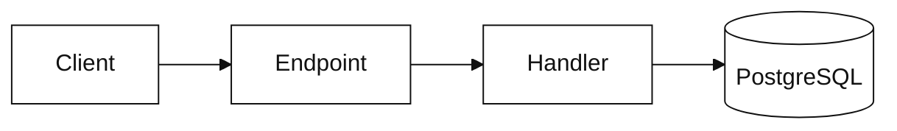

<!--
  ATTRIBUTION POLICY: NO AI ATTRIBUTION.
  This PR must not mention AI tools, assistants, models or agents anywhere: not in the title,
  the description, the commits or the comments. No "Generated with ..." footer, no AI
  "Co-Authored-By" trailer, no tool badge or link. The human author owns and signs every line.

  HOW TO FILL THIS TEMPLATE
  - Title: Conventional Commits, imperative, under 72 characters.
    Example: `feat(orders): open a tab from the floor plan`
  - The document is a funnel: a reviewer who reads only "Story" must understand the change;
    each later part adds depth for whoever needs it.
  - Delete every section that does not apply, heading included; never leave it empty or write "N/A".
    Always keep: Story, Context (Problem, Goals), Design (Overview), Verification (Tests),
    Reviewer guide and Checklist. If a parent heading loses all its subsections, delete it too.
  - State only what you observed. Link CI runs, dashboards and issues instead of asserting them.
  - Diagrams: Mermaid only, monochrome, each followed by one or two sentences that explain it.
    Choose the diagram types that explain the change best (flowchart, sequence, state, ER, class,
    C4, timeline, gantt). Start every diagram with this exact line:
    %%{init: {'theme':'base','themeVariables':{'primaryColor':'#ffffff','primaryTextColor':'#111111','primaryBorderColor':'#111111','secondaryColor':'#f2f2f2','tertiaryColor':'#e6e6e6','lineColor':'#111111','textColor':'#111111','noteBkgColor':'#f2f2f2','noteTextColor':'#111111','noteBorderColor':'#111111','actorBkg':'#ffffff','actorBorder':'#111111','signalColor':'#111111'}}}%%
-->

## Story

<!--
  Tell the change as a short story in three to five paragraphs, in this order:
  before (who felt what pain), the problem (with evidence), the change this PR makes, and after
  (what that same person can now do). Write for someone who has never seen the issue.
-->

**Outcome:** <!-- one sentence: what is true after this merges that was not true before -->

Closes #<!-- issue number -->

| Type | Modules | Risk | User-facing change | Breaking change |
|---|---|---|---|---|
| <!-- feat · fix · refactor · perf · chore · docs · test --> | <!-- e.g. Orders, Platform --> | <!-- low · medium · high --> | <!-- yes · no --> | <!-- yes · no --> |

## Context

### Problem

<!-- What is wrong or missing today, with evidence: issue, incident, metric, customer report. -->

### Goals

<!-- What this PR must achieve, as verifiable statements. -->

1.

### Non-goals

<!-- Things a reviewer could reasonably expect here that this PR deliberately does not do. -->

1.

## Design

### Overview

<!-- Required: one diagram that places the change in the system (modules, services, data stores). -->



<!-- Explain the diagram. -->

### Detailed design

<!--
  How the change works, step by step. Add the diagrams that make it obvious:
  a sequence for a request or message path, a state diagram for a lifecycle,
  an ER diagram for new or changed tables.
-->

### API

<!-- Every endpoint added, changed or removed. Put request/response examples in the collapsible block. -->

| Method | Route | Policy | Idempotent | Responses | Change |
|---|---|---|---|---|---|
| | | | | | added · changed · removed |

<details>
<summary>Examples</summary>

```http
```

</details>

### Data

<!-- Tables, columns, indexes, RLS policies and migrations. Name the expand/contract step and any backfill. -->

| Object | Change | Migration step | Backfill | Locks or downtime |
|---|---|---|---|---|
| | | | | |

### Events

<!--
  Every event this PR publishes, consumes or changes, domain and integration alike.
  For integration events give the full contract: subject, version, payload example, ordering and the
  consumer's idempotency key. Changing a published event needs a new version published in parallel.
-->

| Event | Kind | Version | Subject | Producer | Consumers | Ordering | Idempotency key | Change |
|---|---|---|---|---|---|---|---|---|
| | domain · integration | | | | | | | added · changed · removed |

<details>
<summary>Payload examples</summary>

```json
```

</details>

### Jobs

<!-- Scheduled or deferred work: trigger, schedule, the command it enqueues, retries and dead-letter behavior. -->

| Job | Trigger | Schedule | Enqueued command | Retries and dead letters | Change |
|---|---|---|---|---|---|
| | cron · deferred · one-shot | | | | added · changed · removed |

## Decisions

### Decisions made

<!-- One row per meaningful choice. Mark any deviation from the conventions and link the rule. -->

| # | Decision | Alternatives considered | Rationale | Trade-off |
|---|---|---|---|---|
| D1 | | | | |

### Open decisions

<!-- What is not decided yet, the assumption this PR makes meanwhile, and who decides. -->

| # | Question | Assumption in this PR | Owner | Blocks merge |
|---|---|---|---|---|
| O1 | | | | yes · no |

## Cross-cutting concerns

### Security and privacy

<!-- Authorization (403 vs 404), tenant isolation, personal data and its classification, secrets, outbound calls. -->

### Performance and metrics

<!-- Measured numbers only, with the method. New or changed metrics, spans and alerts go in Observability. -->

| Measure | Before | After | Method |
|---|---|---|---|
| | | | |

### Observability

<!-- Metrics, spans, log events and alerts added or changed (names and labels), and where to watch them. -->

### Compatibility

<!-- Effect on clients, published contracts and data written by older versions. If breaking: who must act, and how. -->

## Verification

### Tests

| Level | What it proves | Evidence |
|---|---|---|
| Unit | | |
| Integration | | |
| Architecture / required | | |
| Manual | | |

### Validate locally

<!-- Numbered steps a reviewer can copy, each with its expected result. -->

1.

## Release

### Rollout

<!-- Order of deployment and prerequisites: migrations, configuration, feature flags. What to watch afterwards. -->

### Rollback

<!-- How to undo it, and whether rollback loses or corrupts data. -->

### Follow-ups

<!-- Work deliberately left for later, each with its issue link. -->

## Reviewer guide

<!-- Where to start, the reading order, and the parts that need the closest look. -->

1.

## Checklist

- [ ] The title is a Conventional Commit, and "Story" explains why, not only what.
- [ ] Sections that do not apply are deleted; every remaining section is filled.
- [ ] Diagrams are Mermaid, monochrome and explained.
- [ ] Every decision and open decision is recorded.
- [ ] Every endpoint and every event published, consumed or changed is listed with its contract.
- [ ] Every check I claim is a check I ran, with evidence linked.
- [ ] Docs, OpenAPI and conventions are updated where behavior changed.
- [ ] No secrets, personal data or tenant identifiers in code, logs, examples or screenshots.
- [ ] No AI attribution in the title, description, commits or comments.

<!--
  ATTRIBUTION POLICY: NO AI ATTRIBUTION.
  Before you submit, read the title, this description and every commit message once more.
  Remove any mention of AI tools, assistants, models or agents, any "Generated with ..." footer
  and any AI "Co-Authored-By" trailer. The human author is the only author.
-->
