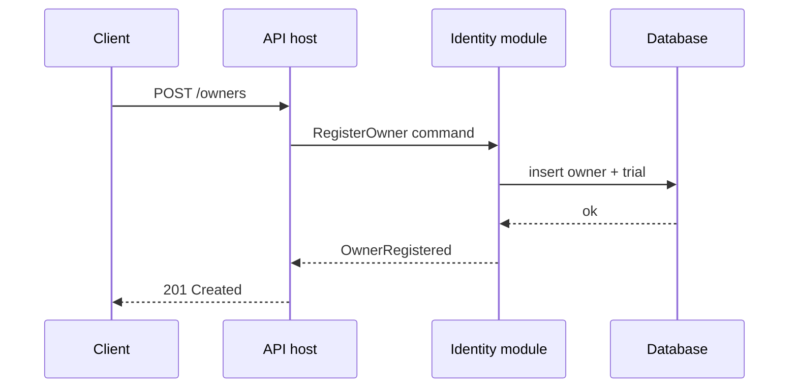
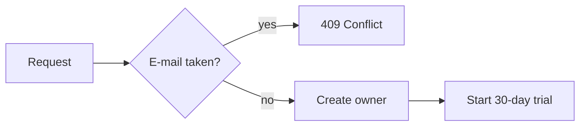

<!--
============================================================================
 READ FIRST. These are hard rules, and CI enforces them (pr-hygiene.yml).
============================================================================

 1. NO AI ATTRIBUTION, anywhere: not in the title, the body, or any commit.
      - no "Co-authored-by:" trailers naming an AI tool or bot e-mail
      - no "Generated with ..." / "Generated by ..." lines
      - no robot-emoji "generated" lines
    The "PR has no AI attribution" job runs scripts/git/check-ai-attribution.sh
    and fails the PR when it finds any of these. You own the change, so you sign it.

 2. TITLE = Conventional Commit, lowercase subject, imperative mood:
      type(scope)?: subject
    Allowed types: feat fix docs style refactor perf test build ci chore revert
    Examples:
      feat(identity): add owner sign-up with 30-day trial
      fix(identity): reject duplicate e-mail on registration
      refactor(platform): extract clock abstraction into shared kernel
      ci: cache nuget packages between jobs
    Rejected: "Feat: Add signup", "fix: Fixed stuff", "WIP".

 3. WRITE IN ENGLISH. Tell a story, not a changelog. Avoid emojis.

 4. Every instruction lives in an HTML comment like this one, so it never
    renders. Replace the placeholders and delete any optional section that
    does not apply. Leave the comments in place: they are invisible.

 Labels: the type:* and module:/area:* labels are applied automatically.
 Add "breaking" yourself if the change breaks a public contract.
============================================================================
-->

## TL;DR

<!--
2 to 4 sentences, readable by someone who will read nothing else:
the problem, what this PR changes, and why it matters. Lead with the outcome.
Example: "Owners could not create an account without a card, which blocked the
trial funnel. This PR adds e-mail + password sign-up with a 30-day no-card trial
in the Identity module. New owners can now reach their first table in one flow."
-->

Closes #<!-- issue number, or delete this line -->

## The story

<!--
A short narrative in two beats. Write prose, not bullet dumps.

Context: what was true before, who it hurt, and why now. Link the issue, ADR,
or discussion.

Approach: how you solved it, and the key insight. Mention what you tried and
dropped only if it helps the reviewer; the Decisions section holds the details.

The description lives on in history. It must make sense without the diff.
-->

**Context.**

**Approach.**

## What changed

<!--
Group by module or area so a reviewer can map each item to the diff.
Use the same names as the labels (module:identity, area:platform, area:host,
area:tests, area:ci, area:docs, area:config, area:deps). One line per change,
and say WHAT and WHY, not "updated file X". Delete the groups you did not touch.
-->

**module:identity**
-

**area:platform**
-

**area:tests**
-

## Diagram

<!--
One mermaid flowchart or sequence diagram showing the flow this PR introduces
or changes.
No colors or styles: keep it structural. Do not use style, classDef, linkStyle,
or %%{init}%% theme directives.
Delete this section if the change has no flow worth drawing.

Minimal neutral example (copy it outside this comment and adapt it):



Or a flowchart:


-->

## Decisions

<!--
ADR-lite: one row per decision a reviewer might question. Record the
alternatives you rejected, so nobody has to reverse-engineer your reasoning.
Consequences include the costs you accept, not only the benefits.
If a decision is big or long-lived, write a real ADR and link it here.
-->

| Decision | Alternatives considered | Why this one | Consequences / tradeoffs |
|---|---|---|---|
| | | | |

## Pending and follow-ups

<!--
State what is deliberately NOT in this PR. Unchecked boxes are open work.
Link an issue for each item, or write "(no issue yet)". Write "None" if done.
-->

- [ ] <!-- follow-up --> (#issue)

## How to verify

<!--
Exact commands a reviewer can copy, then manual steps, then evidence
(test output tail, screenshots, curl transcripts, logs).
Delete the commands that do not apply.
-->

```bash
just test fast
just test integration
just lint
```

**Manual steps**

1.

**Evidence**

<!-- Paste output, or link the CI run. -->

## Risk and rollout

<!--
Blast radius: who or what breaks if this is wrong?
Migrations: is the schema or stored data changed? Is it reversible?
Config: any new or changed settings, env vars, or secrets?
Rollback: the exact steps (a revert is enough? a down-migration? a flag?).
-->

- **Blast radius:**
- **Migrations:** none
- **Config:** none
- **Rollback:** revert this PR

**High-risk areas touched** <!-- check every one that applies; explain each in the Reviewer guide -->

- [ ] Data or migrations (schema, stored data, persisted formats)
- [ ] Security or auth (authentication, permissions, secrets, guards)
- [ ] Public contracts (HTTP API, events, config formats, CLI)
- [ ] Concurrency (locks, races, async ordering)
- [ ] Delivery, CI or dependencies
- [ ] Paths no test covers

## Reviewer guide

<!--
Where to start reading (a file or a commit), the order that makes the diff
make sense, and the one or two spots that deserve the most scrutiny.
Point out generated, moved, or mechanical files that can be skimmed.
-->

- **Start here:**
- **Scrutinize:**
- **Skim:**

## Checklist

- [ ] Tests added or updated, and `just test` passes locally
- [ ] Docs or README updated where behavior or setup changed
- [ ] Analyzers and formatting clean (`just lint`), with no new warnings suppressed
- [ ] Title is a Conventional Commit with a lowercase subject
- [ ] `breaking` label added if a public contract breaks (type/module labels are automatic)
- [ ] No AI attribution in the title, body, or commits
