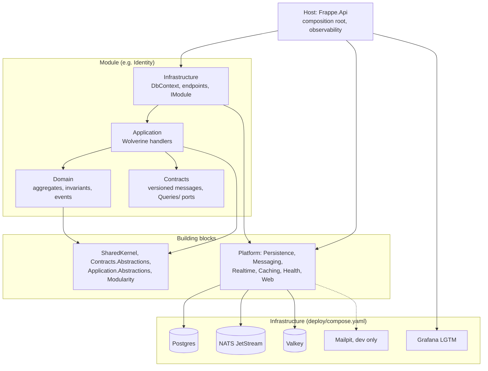
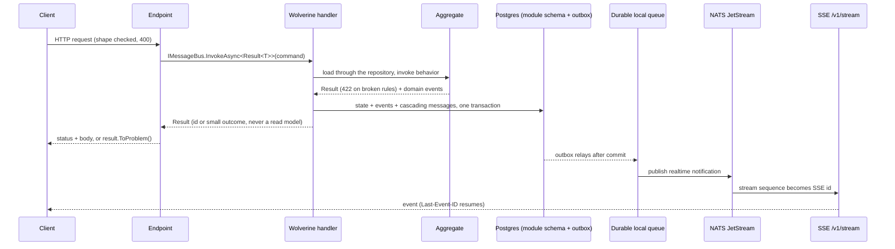
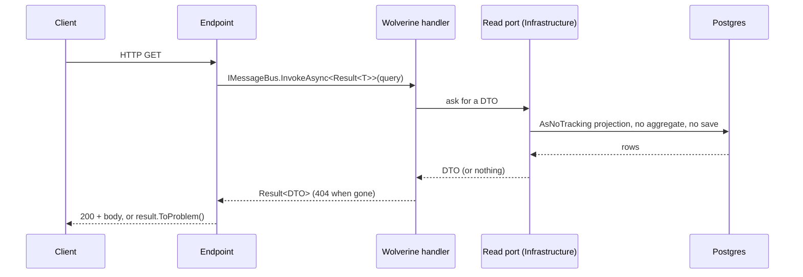

# frappe-api

Backend of Frappé: a .NET 10 hexagonal modular monolith.

## What this is

Frappé is a commercial product for restaurants. It covers back office, catalog, dining-room service, kitchen,
cash, payments, fiscal invoicing, inventory and procurement, plus a public digital menu. Product docs live in the
sibling `frappe-docs` repository.

One deployable host (`Frappe.Api`) composes business modules through a single seam, `IModule`. Each module is split
into Domain, Application, Infrastructure and Contracts projects and owns its own Postgres schema. Modules talk to
each other only through Contracts. Cross-cutting concerns (persistence, messaging, realtime, caching, health, web)
live in shared platform building blocks. Wolverine runs handlers, the transactional outbox and durable queues.
Realtime pushes go to NATS JetStream and reach clients over SSE.

## Quickstart

Prerequisites: the .NET SDK pinned in `global.json` (10.0.x), Docker, [just](https://just.systems), curl and jq.
Or open the repository in its devcontainer (`.devcontainer/`), which has them all.

```sh
just setup   # local tools, packages and git hooks
just doctor  # reports anything missing
just dev     # stack up, migrations applied, API with hot reload (safe to rerun)
just seed    # in another terminal: a verified dev owner, credentials in scripts/dev/seed-owner.env
```

| What | Where |
| --- | --- |
| API | http://localhost:5131 |
| API reference (Scalar, Development only) | http://localhost:5131/scalar/v1 |
| Requests for the main flows | `src/Host/Frappe.Api/http/*.http` (environment `dev`) |
| Mail sent in Development (Mailpit) | http://localhost:8025 |
| Grafana (logs, traces, metrics) | http://localhost:3000 |
| Liveness / readiness | `/health/live`, `/health/ready` |

Development never sends real mail. More in [docs/development.md](docs/development.md); when something breaks,
[docs/troubleshooting.md](docs/troubleshooting.md).

## Architecture



A command, end to end:



A query, end to end:



## Documentation

| Doc | What it covers |
| --- | --- |
| [Development](docs/development.md) | Daily loop, seeding, mail, API UI, tests by name, hooks, devcontainer |
| [Conventions](docs/conventions.md) | Dependency rules, CQRS, endpoints, errors, localization, messages between modules, metrics |
| [Database](docs/database.md) | Schemas, migrations, connection pools and PgBouncer, per-module roles |
| [Quality gates](docs/quality.md) | Analyzers, coverage, mutation, recipes and the workflows that call them |
| [Deploy](docs/deploy.md) | Image, settings, key rotation |
| [Troubleshooting](docs/troubleshooting.md) | Symptoms and fixes |

## Repository layout

```
.config/            dotnet-tools.json, stryker-config.json, commitlint config
.github/            workflows, composite actions, labels, labeler, Dependabot
deploy/             Dockerfile (+ .dockerignore), the local compose stack, the Postgres role plan
docs/               conventions, development, database, deploy, quality gates, troubleshooting
eng/                build-consumed quality rules: banned APIs, complexity thresholds, Sonar
scripts/git/        commit, branch and AI-attribution checks; pre-commit and commit-msg hooks
scripts/dev/        doctor, seed and the dev owner's credentials
src/BuildingBlocks/ SharedKernel, abstractions, Modularity (IModule), Platform.*
src/Modules/        one folder per module: .Domain, .Application, .Infrastructure, .Contracts
src/Host/           Frappe.Api, the composition root
tests/              unit, architecture and integration (Testcontainers) tests
```

Only files tools must find at the root live there: `global.json`, `Directory.*.props`, `.editorconfig`,
`.gitignore`, `Frappe.slnx`, `justfile`, `LICENSE`, plus `.devcontainer/`.

## Contributing

`just setup` installs the local hooks: pre-commit runs `dotnet format --verify-no-changes` on staged C# files,
commit-msg checks the Conventional Commit header and AI attribution.

| Rule | Check | Enforced by |
| --- | --- | --- |
| Branch is `<type>/<kebab-slug>` | `just branch` | `pr-hygiene.yml` |
| Commits and PR title follow Conventional Commits | `just commits` | `pr-hygiene.yml` |
| No AI attribution in commits, PR title or body | commit-msg hook | `pr-hygiene.yml` |
| Exactly one `type:*` label (from the PR title) plus a `module:*` or `area:*` label (from changed paths) | automatic | `pr-triage.yml` |
| PR is assigned to its author | automatic | `pr-triage.yml` |

Labels are declared in `.github/labels.yml` and synced by `labels-sync.yml`; path rules live in
`.github/labeler.yml`. Fill in the [PR template](.github/pull_request_template.md).

## License

Proprietary. Copyright (c) 2026 NULLED SOFTWARE. All rights reserved. See [LICENSE](LICENSE).
