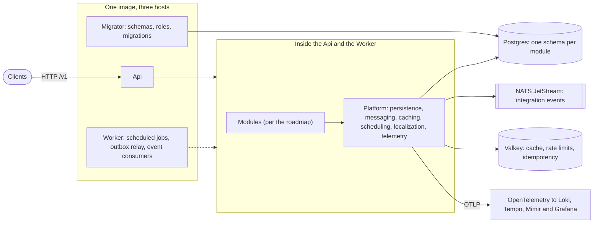

# Frappé API

[](https://github.com/MathiasHilgert/frappe-api/actions/workflows/ci.yml)
[](https://github.com/MathiasHilgert/frappe-api/actions/workflows/security.yml)
[](https://github.com/MathiasHilgert/frappe-api/releases)
[](LICENSE)

The backend of Frappé, the operating system for restaurants and cafés in Latin America.

[Getting started](#getting-started) · [Architecture](#architecture) · [Conventions](#conventions) ·
[Documentation](#documentation) · [Contributing](CONTRIBUTING.md)

## About

Frappé is a modular monolith on .NET 11: one codebase and one deployable image, split into business modules that own
their data and talk to each other through integration events. Each module is a hexagon (domain, application,
infrastructure, HTTP adapter) with CQRS, and the cross-cutting work (persistence, messaging, caching, scheduling,
localization, observability, health) lives once in a shared platform layer.

**Status: platform base.** The shared platform and the three hosts (Api, Worker, Migrator) are in place and run with an
empty module list. Business modules arrive next, in the order of the [roadmap](docs/roadmap.md): Identity first.

Every response is localized (English, Spanish and Portuguese variants), errors follow one
[Problem Details](https://www.rfc-editor.org/rfc/rfc9457) contract, and successful answers are cacheable with `ETag`s.
The full list of endpoints lives in the OpenAPI document, not here: see [Documentation](#documentation).

## Architecture



- **Modules own their data.** Each has its own Postgres schema and a database role with data-only access to it; the
  Migrator provisions schemas, roles and grants for every database participant.
- **Events, not shared tables.** A module publishes integration events through a transactional outbox, relayed to NATS
  JetStream as CloudEvents; each consumer deduplicates through its own inbox.
- **One way to answer.** Use cases return a `Result`; the HTTP layer maps it to a typed answer or a localized Problem
  Details in one place.
- **The rules are tested.** Layering is checked on the compiled assemblies, so a module that reaches into
  infrastructure, or a host that pulls in what it should not, fails the architecture tests.

## Tech stack

| Area | Choice |
|------|--------|
| Runtime | .NET 11, ASP.NET Core, OpenAPI with a [Scalar](https://scalar.com/) reference |
| Data | PostgreSQL, EF Core (Npgsql), NodaTime |
| Messaging | NATS JetStream, CloudEvents |
| Caching | FusionCache over Valkey |
| Scheduling | Quartz.NET on Postgres |
| Observability | OpenTelemetry into Grafana's LGTM stack (Loki, Grafana, Tempo, Mimir) |
| Testing | TUnit, Testcontainers, NetArchTest |
| Tooling | Docker Compose, [just](https://github.com/casey/just), Renovate, release-please |

## Getting started

### Prerequisites

- [Docker](https://docs.docker.com/get-docker/) with Compose
- [just](https://github.com/casey/just#installation)
- The .NET 11 SDK pinned in [`global.json`](global.json), only to build, test or run the hosts outside containers

### Run the whole stack

```bash
cp deploy/.env.example deploy/.env   # local-only placeholder values; choose your own if the machine is shared
just stack up                        # infrastructure, Migrator, Api, Worker and Grafana's LGTM stack
just stack health                    # readiness of the Api and the Worker
```

| Service | URL |
|---------|-----|
| API reference (Scalar) | <http://localhost:8080/docs/> |
| OpenAPI document | <http://localhost:8080/openapi/v1.json> |
| Health probes | <http://localhost:8080/health/ready> (also `/health/live` and `/health/startup`) |
| Grafana (traces, logs, metrics; datasources only, no dashboards yet) | <http://localhost:3000> |

A port that is taken on your machine can be moved in `deploy/.env` (for example `API_PORT=18080`). Services without
authentication (Valkey, NATS, the telemetry backends) listen on `127.0.0.1` only. `just stack down` stops everything and
keeps the data; `just stack reset` also deletes it; `just stack logs` and `just stack ps` show what is running.

### Run the hosts from your IDE

```bash
just infra up      # only the infrastructure and LGTM
just db migrate    # roles, schemas and migrations
just db schema     # after a migration: regenerate the committed schema dumps
just run api       # http://localhost:5080
just run worker
```

`just scaffold command|query|error|event|endpoint|bruno` writes the skeleton of a use case (see
[CONTRIBUTING.md](CONTRIBUTING.md)). `just` alone lists every command.

## Testing

```bash
just test all        # platform, architecture, host and Migrator suites (the integration ones need Docker)
just test e2e        # builds the image and runs it end to end, a few minutes
```

`tests/` mirrors `src/`. Unit suites run in process; integration suites run against real Postgres, NATS and Valkey
through Testcontainers rather than mocks of them; the end-to-end suite runs the real image.

Every integration class starts real containers, which dominates a filtered run. Locally, `export FRAPPE_TEST_REUSE=1`
keeps them between runs (never in CI: `CI=true` disables it); `just test reuse-clean` removes them.

## Conventions

| Topic | Rule |
|-------|------|
| Commits and PR titles | [Conventional Commits](https://www.conventionalcommits.org/) with a mandatory scope: `feat(http): add a health probe` |
| Branches | `<type>/<kebab-topic>`, with the type of the title |
| Merging | Squash only: the PR title and description become the commit on `main` |
| Code quality | Warnings are errors; cognitive complexity 15 and cyclomatic complexity 10 per method; lines up to 150 characters |
| Contracts | The HTTP and event contracts are committed in [`contracts/`](contracts/); a breaking change needs `!` in the title |
| Coverage | At least 80% of the production lines a PR changes |
| CI | Every required check is named after what it guarantees, such as "Database migrations are safe" |
| Code rules | One rule per card with an id (`DATA-06`, `CFG-03`…) in [`.agents/skills/frappe-conventions`](.agents/skills/frappe-conventions/SKILL.md) |

The details, and every CI check, are in [CONTRIBUTING.md](CONTRIBUTING.md).

## Documentation

| Where | What |
|-------|------|
| `/docs/` and `/openapi/v1.json` on a running Api | Every endpoint, with its parameters and responses |
| [`tools/bruno/`](tools/bruno/) | A [Bruno](https://www.usebruno.com/) collection that exercises the API |
| [`contracts/`](contracts/) | The committed OpenAPI and integration event contracts |
| [`docs/roadmap.md`](docs/roadmap.md) | The modules in order, what each delivers, and the deferred engineering work |
| [`.agents/skills/forge`](.agents/skills/forge/SKILL.md) | How a change goes from idea to merged PR: planning, writers, critics, QA |
| [CONTRIBUTING.md](CONTRIBUTING.md) | Commands, testing, conventions, CI and the repository layout |
| [`src/Modules/*/README.md`](src/Modules/) | One map per module (Access, Identity, Notifications): doors, features, metrics, events, extensions |

## License

Copyright © 2026 Nülled Software. All rights reserved. This repository is publicly visible, but it is **not open
source**: the source code is proprietary, and no right to use, copy, modify or distribute it is granted without written
permission. See [LICENSE](LICENSE).
