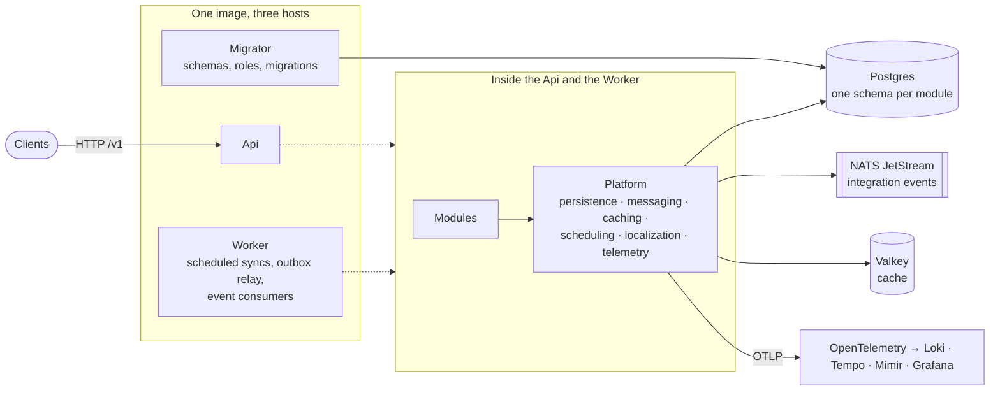

# Frappé API

[](https://github.com/MathiasHilgert/frappe-api/actions/workflows/tests.yml)
[](https://github.com/MathiasHilgert/frappe-api/actions/workflows/code-quality.yml)
[](https://github.com/MathiasHilgert/frappe-api/actions/workflows/security.yml)
[](LICENSE)

The backend of Frappé, the operating system for restaurants and cafés in Latin America.

[Getting started](#getting-started) · [Architecture](#architecture) · [Conventions](#conventions) ·
[Documentation](#documentation) · [Contributing](.github/CONTRIBUTING.md)

## About

Frappé is a modular monolith on .NET 11: one codebase and one deployable image, split into business modules
that own their data and talk to each other through integration events. Each module is a hexagon (domain, application, infrastructure, HTTP adapter) with CQRS,
and the cross-cutting work (persistence, messaging, caching, scheduling, localization, observability, health)
lives once in a shared platform layer.

**Status: early.** The platform and the Geo module are in place (see [docs/geo.md](docs/geo.md)); Geo serves its
country and currency catalog, Argentina's territory and its national and provincial holidays so far. Version 1 of the HTTP API has anonymous reads.

Every response is localized (English, Spanish and Portuguese variants), errors follow one
[Problem Details](https://www.rfc-editor.org/rfc/rfc9457) contract, and successful answers are cacheable with
`ETag`s. The full list of endpoints lives in the OpenAPI document, not here: see [Documentation](#documentation).

## Architecture



- **Modules own their data.** Each has its own Postgres schema and a database role with data-only access to it.
- **Events, not shared tables.** A module publishes integration events through a transactional outbox, relayed to
  NATS JetStream as CloudEvents; consumers deduplicate through an inbox. See
  [ADR 0001](docs/adr/0001-own-messaging-over-cap.md) for why this is built in-house.
- **The rules are tested.** Layering is checked on the compiled assemblies, so a module that reaches into
  infrastructure, or a port that commits on its own, fails the architecture tests.

## Tech stack

| Area | Choice |
|------|--------|
| Runtime | .NET 11, ASP.NET Core, OpenAPI with a [Scalar](https://scalar.com/) reference |
| Data | PostgreSQL, EF Core (Npgsql), NodaTime |
| Messaging | NATS JetStream, CloudEvents |
| Caching | FusionCache over Valkey |
| Scheduling | Quartz.NET |
| Observability | OpenTelemetry into Grafana's LGTM stack (Loki, Grafana, Tempo, Mimir) |
| Testing | TUnit, Testcontainers, WireMock, NetArchTest |
| Tooling | Docker Compose, [just](https://github.com/casey/just), Renovate, release-please |

## Getting started

### Prerequisites

- [Docker](https://docs.docker.com/get-docker/) with Compose
- [just](https://github.com/casey/just#installation)
- The .NET 11 SDK pinned in [`global.json`](global.json), only to build, test or run the hosts outside containers

### Run the whole stack

```bash
cp deploy/.env.example deploy/.env   # then set every empty password in deploy/.env
just stack up          # infrastructure, Migrator, Api, Worker and Grafana's LGTM stack
```

| Service | URL |
|---------|-----|
| API reference (Scalar) | <http://localhost:8080/docs/> |
| OpenAPI document | <http://localhost:8080/openapi/v1.json> |
| Grafana (traces, logs, metrics, alerts) | <http://localhost:3000> |

A port that is taken on your machine can be moved in `deploy/.env` (for example `API_PORT=18080`). `just stack down`
stops everything and keeps the data; `just stack reset` also deletes it.

### Run the hosts from your IDE

```bash
just infra up      # only the infrastructure and LGTM
just db migrate    # roles, schemas and migrations
just run api       # http://localhost:5080
just run worker
```

`just` alone lists every command. The full table is in [CONTRIBUTING.md](.github/CONTRIBUTING.md#commands).

## Testing

```bash
just test all        # platform, architecture and Geo suites (Geo's needs Docker)
just test e2e        # builds the image and runs it end to end, a few minutes
```

`tests/` mirrors `src/`. Each module has a unit suite that runs in process and an integration suite that runs
against real Postgres, NATS and Valkey through Testcontainers rather than mocks of them. The end-to-end suite runs the
real image.

## Conventions

| Topic | Rule |
|-------|------|
| Commits and PR titles | [Conventional Commits](https://www.conventionalcommits.org/) with a mandatory scope: `feat(platform): add a health probe` |
| Branches | `<type>/<kebab-topic>`, with the type of the title |
| Merging | Squash only: the PR title becomes the commit on `main` |
| Code quality | Warnings are errors; every method stays within cognitive complexity 15 and cyclomatic complexity 10 |
| Contracts | The HTTP and event contracts are committed in [`docs/api/`](docs/api/); a breaking change needs `!` in the title |
| Coverage | At least 80% of the production lines a PR changes |
| CI | Every required check is named after what it guarantees, such as "Database migrations are safe" |

The details, and every CI check, are in [CONTRIBUTING.md](.github/CONTRIBUTING.md).

## Documentation

| Where | What |
|-------|------|
| `/docs/` and `/openapi/v1.json` on a running Api | Every endpoint, with its parameters and responses |
| [`docs/http-api.md`](docs/http-api.md) | What every endpoint shares: errors and their codes, languages, caching, rate limiting |
| [`docs/operations.md`](docs/operations.md) | Telemetry, alerts, health probes and runtime settings |
| [`docs/geo.md`](docs/geo.md) | The Geo module: what it answers, its sources and their terms, configuration, metrics, adding a country |
| [`docs/adr/`](docs/adr/) | Architecture decision records |
| [`tools/bruno/`](tools/bruno/) | A [Bruno](https://www.usebruno.com/) collection that exercises the API |
| [`docs/api/`](docs/api/) | The committed OpenAPI and integration event contracts |
| [CONTRIBUTING.md](.github/CONTRIBUTING.md) | Commands, testing, conventions, CI and the repository layout |

## License

Copyright © 2026 Nülled Software. All rights reserved. This repository is publicly visible, but it is **not open
source**: the source code is proprietary, and no right to use, copy, modify or distribute it is granted without
written permission. See [LICENSE](LICENSE).
