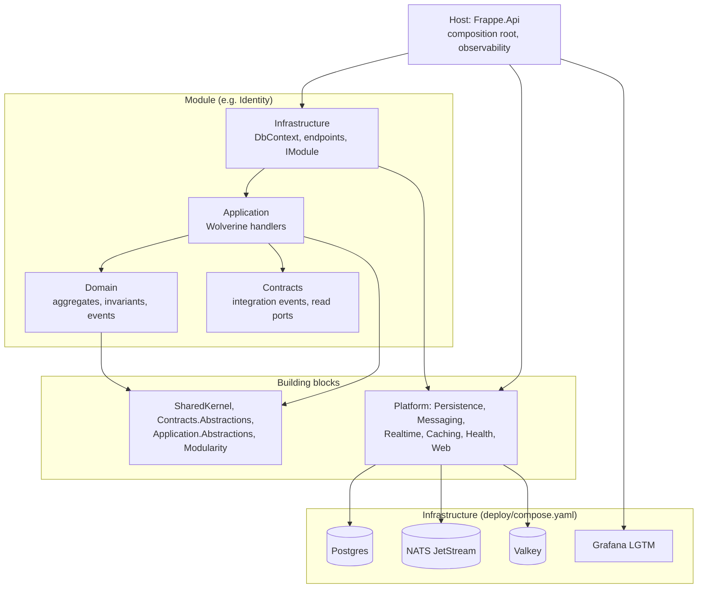
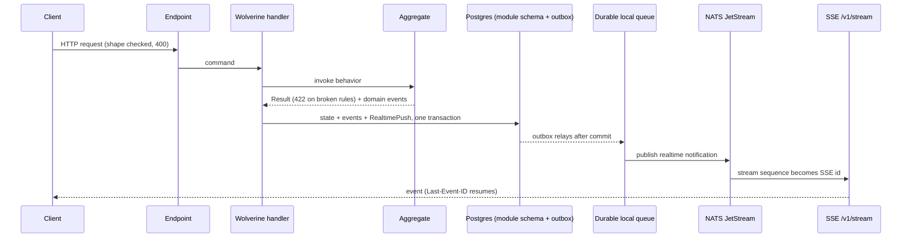

# frappe-api

Backend of Frappé: a .NET 10 hexagonal modular monolith.

## What this is

Frappé is a commercial product for restaurants. It covers back office, catalog, dining-room service, kitchen,
cash, payments, fiscal invoicing, inventory and procurement, plus a public digital menu. Product docs live in the
sibling `frappe-docs` repository.

One deployable host (`Frappe.Api`) composes business modules through a single seam, `IModule`. Each module is split
into Domain, Application, Infrastructure and Contracts projects and owns its own Postgres schema. Modules talk to
each other only through Contracts. Cross-cutting concerns (persistence, messaging, realtime, caching, health, web)
live in shared platform building blocks. Wolverine runs handlers, the transactional outbox and durable queues.
Realtime pushes go to NATS JetStream and reach clients over SSE.

## Quickstart

Prerequisites: the .NET SDK pinned in `global.json` (10.0.x), Docker, and [just](https://just.systems).

```sh
just setup   # dotnet tool restore + restore
just up      # Postgres, NATS JetStream, Valkey, Grafana LGTM (deploy/compose.yaml)
just run     # API with the http launch profile
```

| What | Where |
| --- | --- |
| API | http://localhost:5131 |
| API reference (Scalar, Development only) | http://localhost:5131/scalar/v1 |
| Realtime stream (SSE) | `/v1/stream?businessId=…` |
| Liveness / readiness | `/health/live`, `/health/ready` |
| Grafana (logs, traces, metrics) | http://localhost:3000 |

## Architecture



A command, end to end:



### Dependency rules

- Domain references nothing framework-specific; Application does not reference Infrastructure.
- Other modules may consume only a module's Contracts.
- The host knows modules only through `IModule`.

Enforcement:

- `tests/Frappe.ArchitectureTests` checks the csproj reference graph and the compiled types. Projects are
  classified by name, so a new module is covered with no test changes.
- `eng/BannedSymbols.txt` fails the build in `src/` on `DateTime.Now/UtcNow/Today`, `DateTimeOffset.Now/UtcNow`
  and `Guid.NewGuid`.

## Repository layout

```
.config/            dotnet-tools.json, stryker-config.json, commitlint config
.github/            workflows, composite actions, labels, labeler, Dependabot
deploy/             Dockerfile (+ .dockerignore) and the local compose stack
eng/                build-consumed quality rules: banned APIs, complexity thresholds, Sonar
scripts/git/        commit, branch and AI-attribution checks; commit-msg hook
src/BuildingBlocks/ SharedKernel, abstractions, Modularity (IModule), Platform.*
src/Modules/        one folder per module: .Domain, .Application, .Infrastructure, .Contracts
src/Host/           Frappe.Api, the composition root
tests/              unit, architecture and integration (Testcontainers) tests
```

Only files tools must find at the root live there: `global.json`, `Directory.*.props`, `.editorconfig`,
`.gitignore`, `Frappe.slnx`, `justfile`, `LICENSE`.

## Conventions

| Topic | Rule |
| --- | --- |
| Validation | Domain invariants return `Result<T>` built from a `Notification` (Fowler): all broken rules at once, 422. The HTTP layer checks only request shape, 400. |
| Events / outbox | Aggregates raise domain events; Wolverine scrapes them from EF Core into the outbox in the same transaction. Reactions run from durable local queues. |
| Realtime | A handler returns `RealtimePush.From(notification)` as a cascading message (Wolverine routes only concrete types). It is pushed to NATS JetStream after commit and streamed over SSE; the stream sequence is the SSE id, so `Last-Event-ID` resumes. |
| Jobs | One-off work is a (scheduled) Wolverine message. Recurring work is a Quartz trigger running `PublishCommandJob<T>`, which only publishes a command. |
| Persistence | One schema per module, EF migrations history in that schema. Outside Development the app creates nothing at startup (see [Deploy](#deploy)). |
| Security | Deny by default: every endpoint requires an authenticated user unless it calls `AllowAnonymous()`. |
| Time and ids | Inject `TimeProvider`; ids are UUIDv7 via `Guid.CreateVersion7(timeProvider.GetUtcNow())`. |
| Correlation | Every request gets an id, echoed in `X-Request-Id` and flowed into logs and spans. |
| Modules | `IModule.Name` is also the route segment: endpoints map under `/v1/{Name}`. |

Migrations:

```sh
dotnet ef migrations add <Name> -p src/Modules/Identity/Frappe.Identity.Infrastructure -s src/Host/Frappe.Api -c IdentityDbContext
dotnet ef migrations bundle -p … -s src/Host/Frappe.Api -c IdentityDbContext   # run before the app starts
```

### Health

Any module declares what it needs to be ready, next to where it registers the client:

```csharp
services.AddHealthChecks()
    .AddDependency("postgres", DependencyCriticality.Critical, async (sp, ct) => { /* ping */ });
```

- **Critical** down: `/health/ready` returns 503 and the instance leaves rotation (Postgres).
- **NonCritical** down: `/health/ready` stays 200 with status `Degraded` (NATS, Valkey).
  Valkey is still configuration-required: outside Development a missing `ConnectionStrings__valkey` fails startup
  (checked when the app starts, so `resources setup` does not need it).
- `/health/live` never checks dependencies, so a database outage does not restart every instance.
- Each check times out after 2 s. Results are also exported as the `frappe.health.dependency.status` gauge.

## Quality gates

- **Build:** warnings are errors; `latest-recommended` analysis, code style enforced in build; Sonar, Meziantou
  and Roslynator analyzers on every project.
- **Complexity** (`eng/CodeMetricsConfig.txt`): cyclomatic complexity 10 per method / 50 per type, maintainability
  index 20, class coupling 40 per method / 95 per type.
- **Coverage:** `just cover` fails under 70 % line coverage (`COVERAGE_MIN` overrides).
- **Mutation:** Stryker.NET on SharedKernel and Identity.Domain, nightly; break threshold 50 %.

CI calls the same `justfile` recipes, so `just ci` reproduces the pipeline locally. Run `just` to list recipes.
Linters and scanners run from pinned Docker images. Reports land in `artifacts/`.

| Group | Recipes | Workflow |
| --- | --- | --- |
| dev | `setup`, `up` / `down`, `run`, `clean` | — |
| quality | `fix` (dotnet format), `lint` (format check, actionlint, hadolint, gitleaks) | `ci.yml` |
| test | `build`, `test [fast\|integration\|all]`, `cover`, `mutate` | `ci.yml`, `nightly.yml` |
| security | `audit` (vulnerable NuGet packages, transitive included; secrets are scanned by `lint`); CodeQL weekly | `ci.yml`, `codeql.yml` |
| container | `image`, `image-scan` (trivy, HIGH/CRITICAL) | `ci.yml` |
| git | `commits [base] [head]`, `branch [name]`, `hooks`, `test-git` (tests the hygiene scripts) | `pr-hygiene.yml` |
| ci | `ci` (lint, test-git, build, test all, cover, audit, image, image-scan) | — |

Dependabot updates NuGet, Actions and Docker base images weekly, with Conventional Commit titles.

## Deploy

The image (`deploy/Dockerfile`) is framework-dependent on the chiseled ASP.NET runtime, runs as non-root and
listens on port 8080. Outside Development the app creates no schema at startup, so every deploy runs the same image
once with `resources setup` before starting the new version:

```sh
just image
docker run --rm -e ConnectionStrings__frappe="Host=…" frappe-api:local resources setup   # Wolverine storage schema
docker run -d -p 8080:8080 \
  -e ConnectionStrings__frappe="Host=…" \
  -e ConnectionStrings__valkey="host:6379" \
  -e OTEL_EXPORTER_OTLP_ENDPOINT="http://collector:4317" \
  frappe-api:local
```

| Setting | Required outside Development | Notes |
| --- | --- | --- |
| `ConnectionStrings__frappe` | Yes | Postgres; Critical for readiness |
| `ConnectionStrings__valkey` | Yes | Startup fails without it; NonCritical for readiness |
| `Identity__SecretHashing__Key` | Yes | HMAC key for session tokens and codes, 32+ characters; startup fails without it. Rotating it signs everyone out |
| `Identity__SessionCookie__Name` | No | Session cookie name for the web console, default `frappe_session`; must be a valid cookie token or startup fails |
| `Identity__SessionCookie__Path` | No | Session cookie path, default `/`; must start with `/` |
| `Identity__PasswordHashing__*` | No | Argon2id cost (`MemorySizeKib`, `Iterations`, `Parallelism`); startup fails below the OWASP minimum |
| `ConnectionStrings__nats` | No | Defaults to a local URL; NonCritical, realtime degrades when down |
| `OTEL_EXPORTER_OTLP_ENDPOINT` | No | Traces, metrics and logs over OTLP |

Module EF migrations ship as migration bundles and also run before the app starts.
The orchestrator probes `/health/live` and `/health/ready`; the image has no `HEALTHCHECK` (no shell).

## Contributing

Run `just hooks` once to install the local commit-msg hook.

| Rule | Check | Enforced by |
| --- | --- | --- |
| Branch is `<type>/<kebab-slug>` | `just branch` | `pr-hygiene.yml` |
| Commits and PR title follow Conventional Commits | `just commits` | `pr-hygiene.yml` |
| No AI attribution in commits, PR title or body | commit-msg hook | `pr-hygiene.yml` |
| Exactly one `type:*` label (from the PR title) plus a `module:*` or `area:*` label (from changed paths) | automatic | `pr-triage.yml` |
| PR is assigned to its author | automatic | `pr-triage.yml` |

Labels are declared in `.github/labels.yml` and synced by `labels-sync.yml`; path rules live in
`.github/labeler.yml`. Fill in the [PR template](.github/pull_request_template.md).

## License

Proprietary. Copyright (c) 2026 NULLED SOFTWARE. All rights reserved. See [LICENSE](LICENSE).
