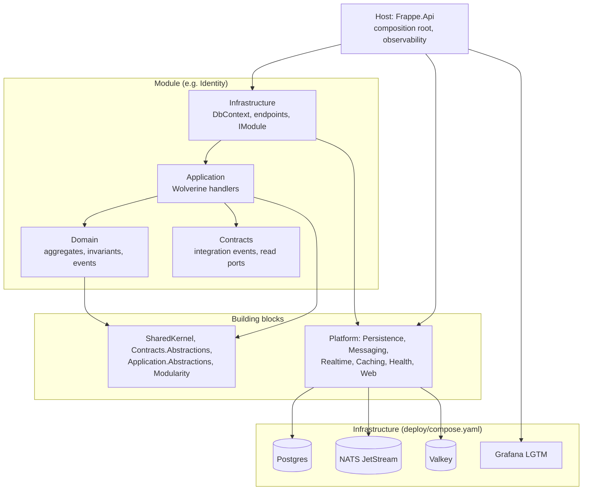
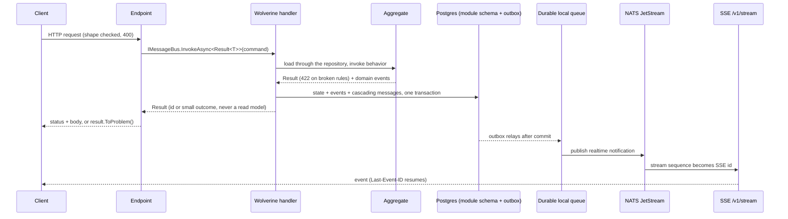
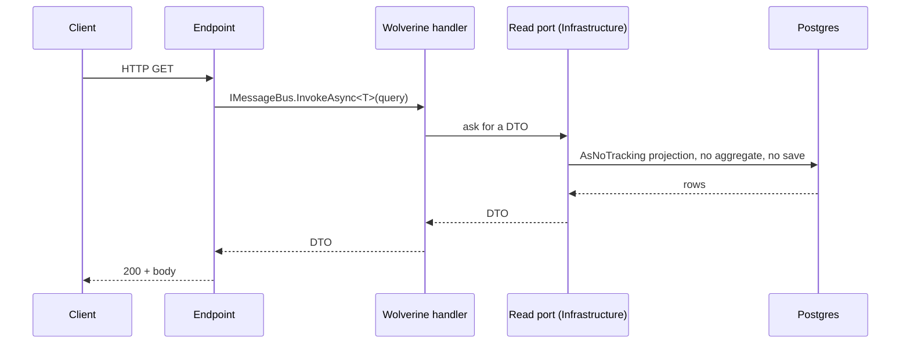

# frappe-api

Backend of Frappé: a .NET 10 hexagonal modular monolith.

## What this is

Frappé is a commercial product for restaurants. It covers back office, catalog, dining-room service, kitchen,
cash, payments, fiscal invoicing, inventory and procurement, plus a public digital menu. Product docs live in the
sibling `frappe-docs` repository.

One deployable host (`Frappe.Api`) composes business modules through a single seam, `IModule`. Each module is split
into Domain, Application, Infrastructure and Contracts projects and owns its own Postgres schema. Modules talk to
each other only through Contracts. Cross-cutting concerns (persistence, messaging, realtime, caching, health, web)
live in shared platform building blocks. Wolverine runs handlers, the transactional outbox and durable queues.
Realtime pushes go to NATS JetStream and reach clients over SSE.

## Quickstart

Prerequisites: the .NET SDK pinned in `global.json` (10.0.x), Docker, and [just](https://just.systems).

```sh
just setup   # dotnet tool restore + restore
just up      # Postgres, NATS JetStream, Valkey, Grafana LGTM (deploy/compose.yaml)
just migrate # apply every module's EF migrations to the local database
just run     # API with the http launch profile
```

Run `just migrate` again whenever a pull brings new migrations; it is a no-op when the database is current.

| What | Where |
| --- | --- |
| API | http://localhost:5131 |
| API reference (Scalar, Development only) | http://localhost:5131/scalar/v1 |
| Realtime stream (SSE) | `/v1/stream?businessId=…` |
| Liveness / readiness | `/health/live`, `/health/ready` |
| Grafana (logs, traces, metrics) | http://localhost:3000 |

## Architecture



A command, end to end:



A query, end to end:



### Dependency rules

- Domain references nothing framework-specific; Application does not reference Infrastructure. The one concession
  to EF Core is a private parameterless constructor on entities and value objects it materializes: neutral C#, no
  attribute or EF comment, so Domain still compiles and reads without any ORM.
- Other modules may consume only a module's Contracts.
- The host knows modules only through `IModule`.

Enforcement:

- `tests/Frappe.ArchitectureTests` checks the csproj reference graph and the compiled types. Projects are
  classified by name, so a new module is covered with no test changes.
- `eng/BannedSymbols.txt` fails the build in `src/` on `DateTime.Now/UtcNow/Today`, `DateTimeOffset.Now/UtcNow`
  and `Guid.NewGuid`.

## Repository layout

```
.config/            dotnet-tools.json, stryker-config.json, commitlint config
.github/            workflows, composite actions, labels, labeler, Dependabot
deploy/             Dockerfile (+ .dockerignore) and the local compose stack
eng/                build-consumed quality rules: banned APIs, complexity thresholds, Sonar
scripts/git/        commit, branch and AI-attribution checks; commit-msg hook
src/BuildingBlocks/ SharedKernel, abstractions, Modularity (IModule), Platform.*
src/Modules/        one folder per module: .Domain, .Application, .Infrastructure, .Contracts
src/Host/           Frappe.Api, the composition root
tests/              unit, architecture and integration (Testcontainers) tests
```

Only files tools must find at the root live there: `global.json`, `Directory.*.props`, `.editorconfig`,
`.gitignore`, `Frappe.slnx`, `justfile`, `LICENSE`.

## Conventions

| Topic | Rule |
| --- | --- |
| Validation | Domain invariants return `Result<T>` built from a `Notification` (Fowler): all broken rules at once. The HTTP layer checks only request shape, 400. Endpoints answer failures with `result.ToProblem()` (see [Errors and localization](#errors-and-localization)). |
| Commands and queries | CQRS lite, see [Commands and queries](#commands-and-queries). |
| Events / outbox | Aggregates raise domain events; Wolverine scrapes them from EF Core into the outbox in the same transaction. Reactions run from durable local queues. |
| Realtime | A handler returns `RealtimePush.From(notification)` as a cascading message (Wolverine routes only concrete types). It is pushed to NATS JetStream after commit and streamed over SSE; the stream sequence is the SSE id, so `Last-Event-ID` resumes. |
| Jobs | One-off work is a (scheduled) Wolverine message. Recurring work is a Quartz trigger running `PublishCommandJob<T>`, which only publishes a command. |
| Persistence | One schema per module, EF migrations history in that schema. Outside Development the app creates nothing at startup (see [Deploy](#deploy)). |
| Security | Deny by default: every endpoint requires an authenticated user unless it calls `AllowAnonymous()`. |
| Time and ids | Inject `TimeProvider`; ids are UUIDv7 via `Guid.CreateVersion7(timeProvider.GetUtcNow())`. |
| Correlation | Every request gets an id, echoed in `X-Request-Id` and flowed into logs and spans. |
| Modules | `IModule.Name` is also the route segment: endpoints map under `/v1/{Name}`. |

### Commands and queries

Every use case is a message with one Wolverine handler, sent from the endpoint with `IMessageBus`, so every use case
gets the same tracing, and every command the same EF Core transaction and outbox.

Handler code is generated ahead of time into `src/Host/Frappe.Api/Internal/Generated` and committed. After adding
or changing a handler (or its dependencies), run `just codegen` and commit the result: Development regenerates
stale code on its own, but production and the integration tests load only the committed code
(`TypeLoadMode.Static`), and CI (`just codegen-check`) fails when it is stale.

| | Command | Query |
| --- | --- | --- |
| Message | `record` implementing `ICommand`, imperative name (`ChangeLocale`) | `record` implementing `IQuery<TResult>` (`GetMe`, `ListOwnerSessions`) |
| Handler | Loads the aggregate through the repository, saves, returns `Result`/`Result<T>` (first in a tuple when it also cascades) with an id or a small value; every failure, rate limits included, is an `Error` | Asks a read port (`IOwnerReads`) for a DTO; marked `[NonTransactional]` |
| Data access | Repository, change tracking, `SaveChangesAsync` | Read port in Infrastructure: `AsNoTracking` projections straight to DTOs |
| Side effects | Cascading messages (`OutgoingMessages`) or `IMessageContext.PublishAsync`, written to the outbox in the same transaction | None |

Layout: Application holds one folder per use case (message, handler and result types together, e.g.
`Sessions/LogIn/`), while the namespace stays the feature area (`...Application.Sessions`) so a type never shares a
name with its namespace. Endpoints live in `<Module>.Infrastructure/Endpoints/`, one `*Endpoints` route group per
feature area with one file per request/response record (`*Request`/`*Response`, unique names); they return a typed
`Results<...>` with `WithSummary` and `ProducesProblem` metadata, read the caller with
`ICurrentPrincipal.RequiredSession()`, the client address with `HttpContext.ClientIp()`, and only map HTTP to a
message and a result to a status or `ToProblem()`. JSON is camelCase everywhere (the framework default). Use-case policy, attempt
limits included, lives in the handler: a throttled command fails with a `TooManyRequests` error carrying
`Error.WithRetryAfter(wait)`, and facts the edge may disclose ride in `Error.WithMetadata(key, value)`. Transport
concerns (cookies through `ISessionCookie`, `Content-Language`) stay in Infrastructure.
A command that only a recurring job publishes (`PurgePendingOwners`) implements `IBackgroundCommand`: nobody reads
its answer and a published handler's return value is cascaded, so it returns only its `OutgoingMessages`.
Errors compare by `Code` and `Field`: `Kind`, `Message` and the occurrence details (`RetryAfter`, `Metadata`) never make
two errors different, so `error == IdentityErrors.EmailTaken` holds for a throttled or annotated copy too.
`tests/Frappe.ArchitectureTests/CqrsConventionTests.cs` fails when an endpoint calls an Application service, a message
is not a marked record, a query handler touches a repository, a command handler answers with a type some query
returns, a command handler returns anything but `Result`/`Result<T>`, a background command handler returns a
`Result`, or a query handler is not `[NonTransactional]`. `EdgeConventionTests.cs` fails when an endpoint builds a
problem itself (`TypedResults.Problem`, `Results.Problem`, `new ProblemDetails`), an endpoint lives outside
`Endpoints/` or is not named `*Endpoints`, or an `Error` is declared outside a `*Errors` catalogue.

Migrations:

```sh
just migration Identity <Name>   # add a migration to a module's Persistence/Migrations
just migrate                     # apply every module's migrations locally (Development)
dotnet ef migrations bundle -p … -s src/Host/Frappe.Api -c IdentityDbContext   # run before the app starts
```

### Health

Any module declares what it needs to be ready, next to where it registers the client:

```csharp
services.AddHealthChecks()
    .AddDependency("postgres", DependencyCriticality.Critical, async (sp, ct) => { /* ping */ });
```

- **Critical** down: `/health/ready` returns 503 and the instance leaves rotation (Postgres).
- **NonCritical** down: `/health/ready` stays 200 with status `Degraded` (NATS, Valkey).
  Valkey is still configuration-required: outside Development a missing `ConnectionStrings__valkey` fails startup
  (checked when the app starts, so `resources setup` does not need it).
- `/health/live` never checks dependencies, so a database outage does not restart every instance.
- Each check times out after 2 s. Results are also exported as the `frappe.health.dependency.status` gauge.

### Errors and localization

Every response says which language it speaks: `Content-Language` is always set and `Vary: Accept-Language` appended.
Platform locales are `es-AR`, `en`, `es-MX`, `pt-BR` (default `en`; override with `Localization:SupportedLocales`
and `Localization:DefaultLocale`). The request locale (`IRequestLocale`) is negotiated by RFC 4647 lookup:

1. Each `Accept-Language` tag in quality order: exact tag, its truncations, then the first configured locale of the
   same language (`es-CL` → `es-AR`). The first servable tag wins, even over a stored preference.
2. Otherwise the principal's stored preference, read through `IPreferredLocaleSource` (the owning module implements it).
3. Otherwise `en`.

Failures are RFC 9457 problems. `result.ToProblem()` picks the status from `Error.Kind` (422 validation, 404, 409,
429 with `Retry-After` from the longest `Error.RetryAfter`, 401, 403; mixed kinds answer 422), sets `type` to
`urn:frappe:problem:<code>` (one error) or `urn:frappe:problem:validation` (several), and translates `title` and each
`errors[].message` by error code. A code with no catalogue entry falls back to `Error.Message`, in English. One error
also sets `detail` (same text) and `code`, and every `Error.Metadata` entry becomes a top-level member (e.g. `ownerId`
on a pending owner's login; the keys live in the module's Contracts, `IdentityErrorMetadata`). Endpoints never shape
a problem themselves: give the error the right `Kind` instead. A 401/403 from authorization (challenge or forbid)
answers the same shape with `platform.auth.required` or `platform.auth.forbidden` (`PlatformErrors`).

A module adds strings as flat ICU MessageFormat catalogues, one file per locale, keyed by error code or a
module-prefixed key:

```xml
<EmbeddedResource Include="i18n/*.json" />   <!-- i18n/en.json, i18n/es-AR.json, i18n/es-MX.json, i18n/pt-BR.json -->
```

```json
{ "identity.email.taken": "That email is already registered.",
  "identity.codes.left": "{count, plural, one {# attempt left} other {# attempts left}}" }
```

Register them with `services.AddMessageCatalog(typeof(SomeModuleType).Assembly)` and format with
`IMessageCatalog.Format(locale, key, args)`. A key missing in a locale falls back to another region of the same
language, then to `en`; a key missing in `en` throws. In the module's tests:

```csharp
MessageCatalogConformance.Check(assembly).ShouldBeEmpty();                 // every en key in every locale, every message formats
MessageCatalogConformance.CodesWithoutEntries(assembly, codes).ShouldBeEmpty(); // every error code translated
```

## Quality gates

- **Build:** warnings are errors; `latest-recommended` analysis, code style enforced in build; Sonar, Meziantou
  and Roslynator analyzers on every project.
- **Complexity** (`eng/CodeMetricsConfig.txt`): cyclomatic complexity 10 per method / 50 per type, maintainability
  index 20, class coupling 40 per method / 95 per type.
- **Coverage:** `just cover` fails under 70 % line coverage (`COVERAGE_MIN` overrides).
- **Mutation:** Stryker.NET on SharedKernel and Identity.Domain, nightly; break threshold 50 %.

CI calls the same `justfile` recipes, so `just ci` reproduces the pipeline locally. Run `just` to list recipes.
Linters and scanners run from pinned Docker images. Reports land in `artifacts/`.

Tests build once and never rebuild: `just test` and `just cover` run `just build`, then launch every test
project's Microsoft.Testing.Platform executable in parallel and print each one's output whole. `just cover`
collects coverage during that single run and merges it, so CI runs each suite exactly once.

| Group | Recipes | Workflow |
| --- | --- | --- |
| dev | `setup`, `up` / `down`, `run`, `clean` | — |
| quality | `fix` (dotnet format), `lint` (format check, actionlint, hadolint, gitleaks) | `ci.yml` |
| test | `build`, `test [fast\|integration\|all]`, `cover`, `mutate` | `ci.yml`, `nightly.yml` |
| security | `audit` (vulnerable NuGet packages, transitive included; secrets are scanned by `lint`); CodeQL weekly | `ci.yml`, `codeql.yml` |
| container | `image`, `image-scan` (trivy, HIGH/CRITICAL) | `ci.yml` |
| git | `commits [base] [head]`, `branch [name]`, `hooks`, `test-git` (tests the hygiene scripts) | `pr-hygiene.yml` |
| ci | `ci` (lint, test-git, cover (build + every suite), audit, image, image-scan) | — |

Dependabot updates NuGet, Actions and Docker base images weekly, with Conventional Commit titles.

## Deploy

The image (`deploy/Dockerfile`) is framework-dependent on the chiseled ASP.NET runtime, runs as non-root and
listens on port 8080. Outside Development the app creates no schema at startup, so every deploy runs the same image
once with `resources setup` before starting the new version:

```sh
just image
docker run --rm -e ConnectionStrings__frappe="Host=…" frappe-api:local resources setup   # Wolverine storage schema
docker run -d -p 8080:8080 \
  -e ConnectionStrings__frappe="Host=…" \
  -e ConnectionStrings__valkey="host:6379" \
  -e OTEL_EXPORTER_OTLP_ENDPOINT="http://collector:4317" \
  frappe-api:local
```

| Setting | Required outside Development | Notes |
| --- | --- | --- |
| `ConnectionStrings__frappe` | Yes | Postgres; Critical for readiness |
| `ConnectionStrings__valkey` | Yes | Startup fails without it; NonCritical for readiness |
| `Identity__SecretHashing__Key` | Yes | HMAC key for session tokens and codes, 32+ characters; startup fails without it. Rotating it signs everyone out |
| `Identity__SessionCookie__Name` | No | Session cookie name for the web console, default `__Host-frappe_session`; must be a valid cookie token or startup fails. A `__Host-` name requires Path `/` and no Domain |
| `Identity__SessionCookie__Path` | No | Session cookie path, default `/`; must start with `/` |
| `Identity__SessionCookie__Domain` | No | Unset by default (host-only cookie); not allowed with a `__Host-` name |
| `Identity__PasswordHashing__*` | No | Argon2id cost (`MemorySizeKib`, `Iterations`, `Parallelism`); startup fails below the OWASP minimum. `MaxConcurrentHashes` (default: CPU count, 1..1024) caps hashes running at once; extra sign-ins wait for a slot instead of exhausting memory |
| `Notification__Resend__ApiKey` | Outside Development | Resend API key (secret, never committed). Locally: `dotnet user-secrets set "Notification:Resend:ApiKey" "<key>" --project src/Host/Frappe.Api`. Without it, Development logs mail instead of sending it; elsewhere sending fails and is retried |
| `Notification__Resend__From` | No | Sender address, default `Frappé <no-reply@frappe.la>`; must be a domain verified in Resend |
| `ConnectionStrings__nats` | No | Defaults to a local URL; NonCritical, realtime degrades when down |
| `OTEL_EXPORTER_OTLP_ENDPOINT` | No | Traces, metrics and logs over OTLP |
| `ForwardedHeaders__KnownProxies__0`, `__1`… | Behind a proxy | IPs of the reverse proxies whose `X-Forwarded-For`/`-Proto` are trusted (loopback always is). Unset, the socket address is the client: per-IP rate limits would see only the proxy |
| `ForwardedHeaders__KnownNetworks__0`, `__1`… | Behind a proxy | Same, as CIDR ranges (e.g. `10.0.0.0/8`) |

Module EF migrations ship as migration bundles and also run before the app starts.
The orchestrator probes `/health/live` and `/health/ready`; the image has no `HEALTHCHECK` (no shell).

## Contributing

Run `just hooks` once to install the local commit-msg hook.

| Rule | Check | Enforced by |
| --- | --- | --- |
| Branch is `<type>/<kebab-slug>` | `just branch` | `pr-hygiene.yml` |
| Commits and PR title follow Conventional Commits | `just commits` | `pr-hygiene.yml` |
| No AI attribution in commits, PR title or body | commit-msg hook | `pr-hygiene.yml` |
| Exactly one `type:*` label (from the PR title) plus a `module:*` or `area:*` label (from changed paths) | automatic | `pr-triage.yml` |
| PR is assigned to its author | automatic | `pr-triage.yml` |

Labels are declared in `.github/labels.yml` and synced by `labels-sync.yml`; path rules live in
`.github/labeler.yml`. Fill in the [PR template](.github/pull_request_template.md).

## License

Proprietary. Copyright (c) 2026 NULLED SOFTWARE. All rights reserved. See [LICENSE](LICENSE).
